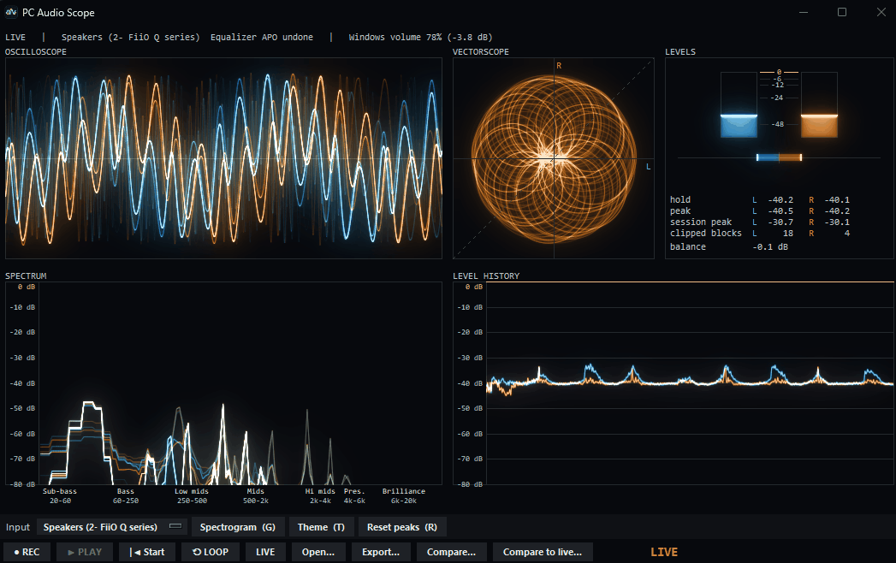
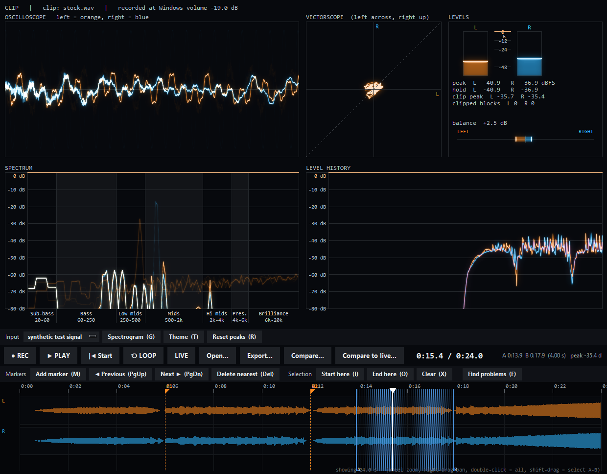
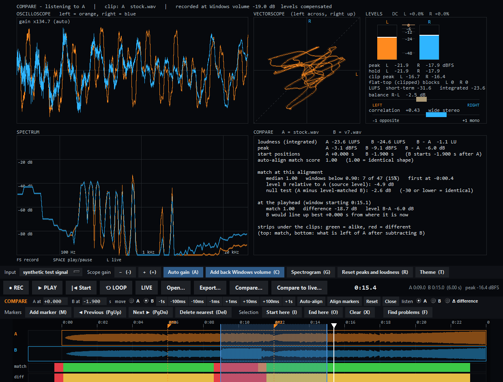
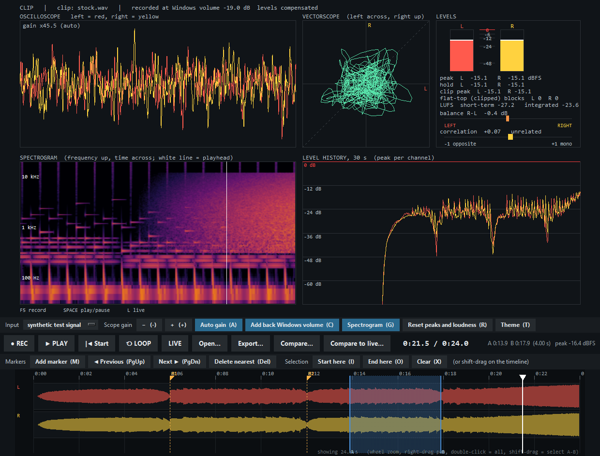
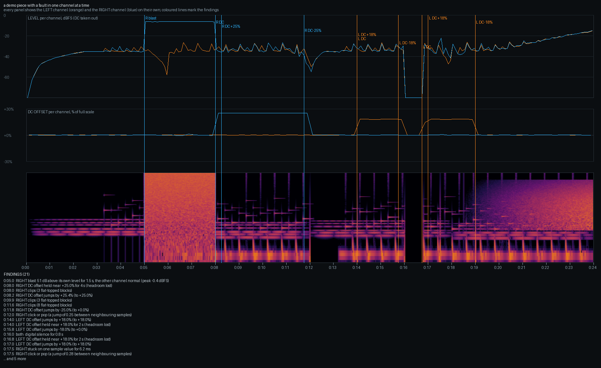
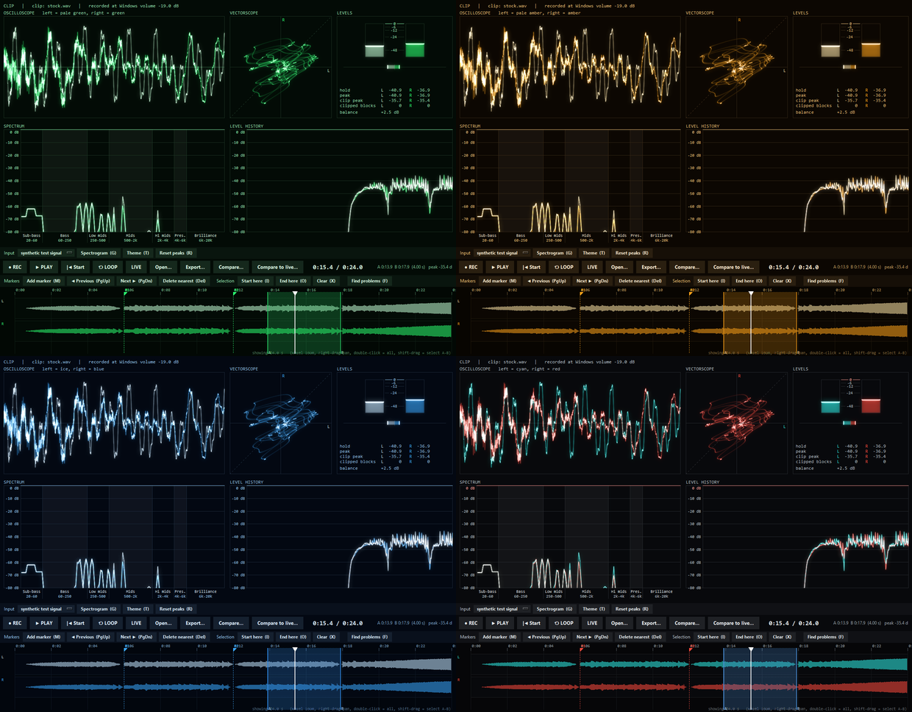

# PC Audio Scope

A scope for the sound your PC is playing, or for any microphone, with a recorder, a timeline player and a tool for
comparing two recordings, or a recording against the sound that is playing right now.

**It was designed so that an AI can listen on the same scope that a person uses.** Most AI assistants cannot play a
recording and cannot watch a screen, but they can read numbers and look at pictures. So everything the scope shows a person is
also available as text, JSON and pictures: every channel is measured on its own (a fault in one channel is invisible in a stereo
mix, and loudness figures ignore DC), faults are found automatically and reported with a time and a channel, and a whole
recording can be summed up in one picture. A person and an AI can look at the same clip, the same markers and the same
findings, and talk about the same moment.

It started as a way to check that two builds of the same game sound the same.



## Download

The ready-made programs are in the [releases](releases) folder:

| platform | download | |
|---|---|---|
| Windows 10 / 11 | [PC-Audio-Scope.exe](releases/PC-Audio-Scope.exe?raw=true) | one file, nothing to install |
| macOS (Apple Silicon, experimental) | built by the [build workflow](https://github.com/synrais/PC-Audio-Scope/actions/workflows/build.yml) | see [macOS](#macos-experimental) below |
| any system with Python | [source code](https://github.com/synrais/PC-Audio-Scope) | see [Run from the source](#run-from-the-source) |

Put the Windows exe in its own folder, because it keeps your recordings next to itself. It is unsigned: Windows
SmartScreen may say "unknown publisher" (More info, Run anyway). The exe unpacks itself on start, so allow a few seconds before
the window appears.

## What it does

**Live view**
- oscilloscope (triggered on the left channel, its gain follows the sound by itself) and a vectorscope that draws like the beam of a CRT: bright where the beam moves slowly and dim where it sweeps, with a glow and a fading afterglow, so XY pictures such as oscilloscope music show clearly (play a lossless file for the cleanest picture). The oscilloscope, the spectrum and the level history are drawn the same way, as a glowing beam with a short afterglow (the level history does not dim its fast strokes, so a dip stays visible)
- peak meters with hold, and a left/right balance meter
- a count of clipped 10 ms blocks per channel (blocks with a flat top at full scale)
- spectrum, with the ranges an equaliser uses named along its bottom (sub-bass 20-60 Hz, bass 60-250, low mids 250-500, mids 500-2k, upper mids 2k-4k, presence 4k-6k, brilliance 6k-20k), or a scrolling spectrogram (`G`), and a 30 second level history (the spectrum and the history share one dB scale, 0 down to -80, so their lines match, and silence is the same bottom line in both)
- double-click the oscilloscope, vectorscope, levels, spectrum or level history and it fills the whole window with nothing else on it (no buttons, no text; the keys still work), double-click again to get everything back
- right-click a window (oscilloscope, vectorscope, levels, spectrum, level history): turn its grid on or off, its info (all its numbers and text) on or off (the full screen window has its own two, so the normal layout can keep its grid and info while the full screens are clean; the border of a window only goes in full screen), **Narrow burn**, **Wide burn** and **Line strength** (rows with an arrow either side: click the arrows, hold one to run, scroll over the row, or use Left / Right, Home and End while the menu is open - it stays open so you can watch the graph change); the spectrogram has just Info, and pick its own left and right colours (the vectorscope has one); the choices are remembered
- **Narrow burn** is the glow of the phosphor beam close to the line (two glows, about 5 and 23 pixels wide at 1080 high), from **0** (all the phosphor effects off: clean lines) up to **3.0** in steps of 0.1. Every window starts on 0.3 except the levels, on 1.0 (the Classic theme keeps its own look: only the vectorscope on 1.0). Above 1.0 the brightest areas burn to white sooner and close lines blend into one glow. **Wide burn** adds a third glow that is very broad and faint (about 78 pixels at 1080 high, like light scattered in the glass of a monitor): a soft haze round bright things that fills the dark between them. It is 0 (off) until you raise it, up to 3.0 in steps of 0.1, and it works on its own: it does not depend on Narrow burn, but is gone with it at 0 (clean lines). **Line strength** (with Narrow burn above 0, not for the level bars) is **1 to 10**: 1 is the beam's brightness as it is, higher raises its weak end so faint and fast strokes look solid instead of see-through (6 is where every window starts). Only the line itself is brightened - the glows, the colours and the level bars are as they were.
- what a first run starts with (anything you choose in a menu is remembered and wins): the **Orange + blue** theme; the enlarged windows have no grid, and no info either - except the spectrum and the level history, which keep their info (the spectrum's range names, the history's dB numbers); the spectrum has no grid in the normal layout either; everything else on. Narrow burn starts at 0.3 for every window except the levels (1.0), and Wide burn at 0.5, 0.3, 0.3, 0.2 and 0.3 (oscilloscope, vectorscope, spectrum, history, levels); the Classic theme keeps its crisp look (only the vectorscope burns, nothing wide)
- input: the Windows default output (follows it when you change device), any other output, or any microphone
- a dark title bar in the colours of the theme (Windows 10 and 11), and the program's own icon on the window and the taskbar

**Record and review**
- the DC offset of each channel appears above the meters once it reaches 1 % (and turns red above 3 %); a clean signal has none, so nothing is shown
- `REC` (`F5`) records what you hear, up to 10 minutes, to `recordings/clip_<date>.wav` and opens it on the timeline
- every panel follows the playhead, so scopes, meters, loudness and the spectrogram all work on a recording
- timeline (collapsed until you record, open a clip or compare; the window grows to fit it): click or drag to seek, wheel to zoom, right-drag to pan, double-click for the whole clip
- markers (`M`), an A-B selection (`I`, `O` or shift-drag) with its own loudness figures, loop (`P`), export of the selection (`E`)
- markers, selection and the Windows volume a clip was recorded at are kept in a small `.json` next to the `.wav`



**Compare two clips**
- both clips sit on a shared timeline, each with its own start position: drag a lane, type a start, nudge it (Alt+arrows),
  drop a marker on the same event in both and press *Align markers*, or press *Auto-align* (it fires once when the
  comparison opens, on the loudest part of A; press it again with a selection to align on that part)
- listen to A, B or the difference between them (`1`, `2`, `3`)
- two strips under the clips show where they match and where they differ; the report gives loudness and peak of both, how
  many windows differ, the level difference and a null test



**Compare a clip with the live sound** (*Compare to live...*)
- play the same sound now and the live input is recorded and compared with the clip as it goes
- the white line is the running point: where in the clip the live sound is. Auto-align fires once after about 6 s of sound;
  click the timeline, drag the live lane or nudge to move it, or press *Auto-align* again
- *Stop live* saves the session as a WAV and opens it as clip B of an ordinary comparison, with the same alignment



## Finding problems: one scope for people and for AI

`F`, or the *Find problems* button, looks through the open clip, **each channel on its own**, and reports what it finds. The
findings replace the level history until you press `F` again, they are marked on the timeline (the markers start with `!`),
and for a saved clip a report, a JSON file and a picture are written next to the WAV (`clip.analysis.txt`, `.json`, `.png`).

It looks for:
- **a channel that blasts** far above its own level while the other one does not (a decoder losing its state, for example)
- **DC offset**: steps, and long stretches where a channel sits off centre (headroom lost, speaker cone pushed to one side)
- **dropouts**: digital silence in the middle of sound, or one channel silent while the other plays
- **stuck output** (a channel staying on one sample value), **clicks and pops**, **clipping**, and passages that are **out of phase**



The same thing from the command line, with no window:

```
python pc_audio_scope.py --analyze clip.wav
python pc_audio_scope.py --analyze reference.wav clip.wav
```

The first writes `clip.analysis.txt` (one line per finding: time, channel, what), `clip.analysis.json` and the overview picture
above: level and DC offset per channel, a spectrogram, and the findings marked on all of them. With two files it also
writes a segment-by-segment comparison: where each stretch of the first recording sits in the second (the offset can change
along the clip), how alike they are there, the level and DC difference of each channel, and a verdict (same, level differs,
DC offset differs, one channel differs, different sound). The same functions are in `pc_audio_scope.py` (`find_problems`,
`compare_clips`, `findings_image`) if you want to call them from your own code.

## Themes

`T` (or the *Theme* button) rolls through the colour schemes: the classic yellow and red, four single-colour phosphor
screens (green, amber, blue, red; the left channel is the paler shade, the right the stronger one) and three two-colour ones that keep the channels
easy to tell apart (blue + orange, green + magenta, cyan + red). Everything is tinted to match, including the
spectrogram, and the traces glow. The choice is remembered.



## Run from the source

Python 3 (tested on 3.11).

```
pip install -r requirements.txt
python pc_audio_scope.py
```

or double-click `Start PC Audio Scope.bat`. If a package is missing the program says which and how to install it. The window
can be resized; everything scales with it, and the size, position and settings are remembered
(`%APPDATA%\PC Audio Scope\settings.json` on Windows).

## Keys

| key | |
|---|---|
| `F5` | record / stop |
| `Space` | play / pause (freezes the scopes when live) |
| `L` | back to live |
| `Ctrl+O` | open a clip |
| `Left` `Right` | seek 1 s (`Shift` 5 s); `Home` `End` jump to the start / end |
| `M` | add a marker; `PageUp` `PageDown` jump between markers; `Delete` removes the nearest |
| `I` `O` `X` | selection start / end / clear |
| `P` | loop the selection (or the whole clip) |
| `F` | find problems in the open clip (shows them, marks them, saves a report) |
| `E` | export the selection (or the whole clip) as a WAV |
| `G` | spectrum / spectrogram |
| `T` | next theme |
| `C` | ignore the Windows volume in the levels, until the program is closed (see below) |
| `U` | switch the undoing of a system equaliser (Equalizer APO) on or off (see below) |
| `R` | reset the peaks (session peak, held peaks, clipped-block counts) |
| `1` `2` `3` | listen to A / B / the difference while comparing |
| `Alt+Left` `Alt+Right` | nudge the chosen clip 10 ms (`Alt+Shift` 1 ms, `Alt+Ctrl` 100 ms) |
| `Q` `Esc` | quit |

## How the levels are measured

On the outputs this was developed with, Windows loopback capture sees the sound after the master volume, so a quiet Windows
volume makes everything read low. The scope reads the volume of the output (read only, it never changes it) and shows the
levels as measured. Press `C` to ignore the Windows volume instead: it is added back, so the numbers are about the level
the program produced (this lasts until the program is closed). Recordings remember the volume they were taken at, and
playback undoes the current volume the same way, so a clip plays about as loud as it was heard, never above full scale.
A muted output is shown in the status line.

**System equalisers.** Windows loopback records the sound *after* the stream effects of the audio engine, so an equaliser such as [Equalizer APO](https://sourceforge.net/projects/equalizerapo/)
(a headphone correction curve, for example) is in what the scope hears. Such a curve is full of phase shifts, which bends the pictures of oscilloscope music in the vectorscope.
The scope reads the Equalizer APO configuration of the output it is capturing (`config.txt`, its `Include:` files and `Device:` lines) and, when all of it is peaking or shelf filters
(`PK`, `LSC`, `HSC`) and a preamp, undoes it with the exact inverse; the status line then says *Equalizer APO undone*. If the configuration holds anything else (a low-pass, a plugin, a
convolution) nothing is undone and the status line says so. `U` switches it off, to see the sound as the headphones get it.

The loudness figures use the BS.1770 K-weighting; a stereo 997 Hz sine at -20 dBFS reads -20.0 LUFS (see `tests/dsp.py`).

## macOS (experimental)

The macOS build is made by GitHub Actions (see below) and has not been run on a Mac by its author, so expect rough edges.
A Mac has no "what you hear" capture of its own: install a virtual audio device such as BlackHole, route the sound to it
(a Multi-Output Device in Audio MIDI Setup lets you listen at the same time) and pick it as the input; microphones work
directly. macOS asks for microphone permission the first time. There is no Windows volume to ignore, so `C` does nothing. The
build is for Apple Silicon. Recordings go to `~/Documents/PC Audio Scope/recordings`.

## Building the program yourself

```
pip install -r requirements.txt pyinstaller
pyinstaller packaging/pc_audio_scope.spec --noconfirm
```

gives `dist/PC Audio Scope.exe` on Windows and `dist/PC Audio Scope.app` on a Mac (PyInstaller builds for the system it runs
on). `PC Audio Scope.exe --check report.txt` starts it hidden for a few seconds on the real sound card and writes a one-line
report. The workflow in `.github/workflows/build.yml` does both builds on GitHub's machines: run it from the Actions tab
(build, Run workflow) and download `PC-Audio-Scope.exe` and `PC-Audio-Scope-macOS.zip` from the finished run; put them in `releases/`.
On a Mac you open the app the first time with right-click, Open (it is unsigned). The icon is drawn by `packaging/make_icon.py`.

## Layout

| | |
|---|---|
| `pc_audio_scope.py` | the whole program: the analysis (loudness, correlation, spectrogram, alignment, comparison), capture, recorder, player and window |
| `tests/` | `python tests/run.py` runs everything in about a minute, in a hidden window with a synthetic input; nothing is played |
| `packaging/` | the PyInstaller recipe and the icon |
| `releases/` | the ready-made programs |
| `docs/` | the pictures above: `live.gif` is a real capture of the program playing music, the others are made by `python tests/screenshots.py` from synthetic data (the analysis picture comes from a demo piece with a fault in each channel) |
| `recordings/` | your clips (created on first use, not part of the repository) |

## Limits

- The Windows version is the one in daily use: capture uses WASAPI loopback through SoundCard and the volume is read through COM.
- Developed and tested on one Windows 11 PC, with current and slightly older NumPy releases.

Built on [SoundCard](https://github.com/bastibe/SoundCard), [sounddevice](https://python-sounddevice.readthedocs.io), NumPy, Pillow and comtypes.
